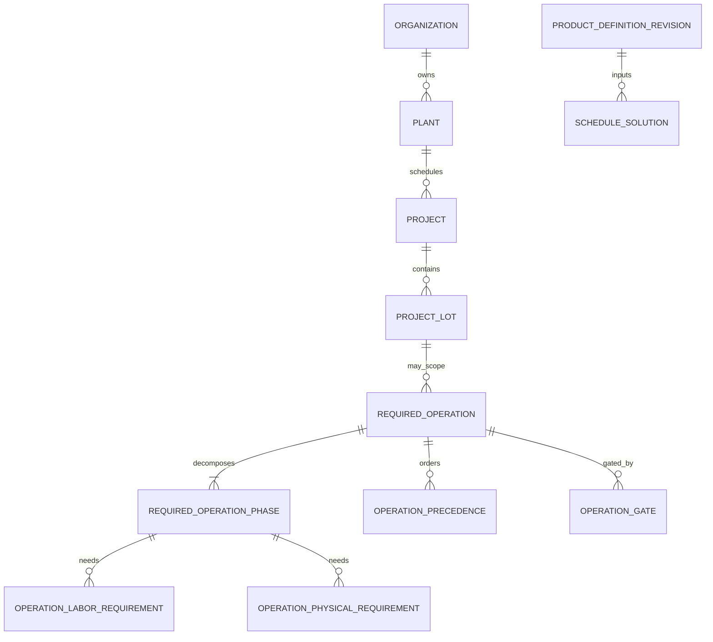
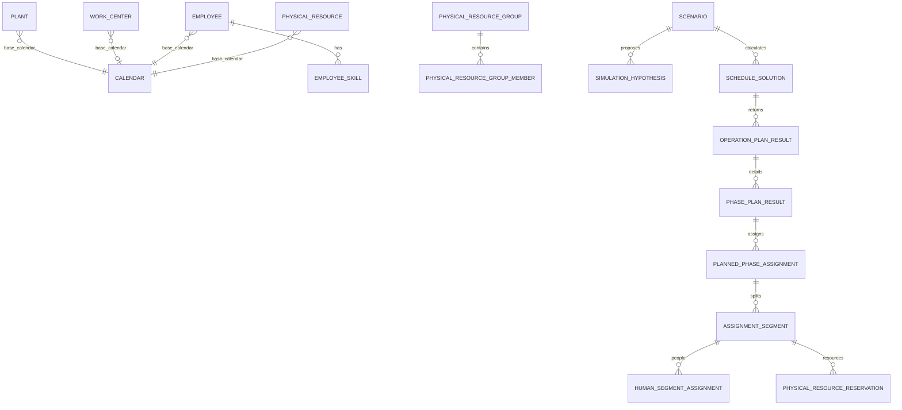
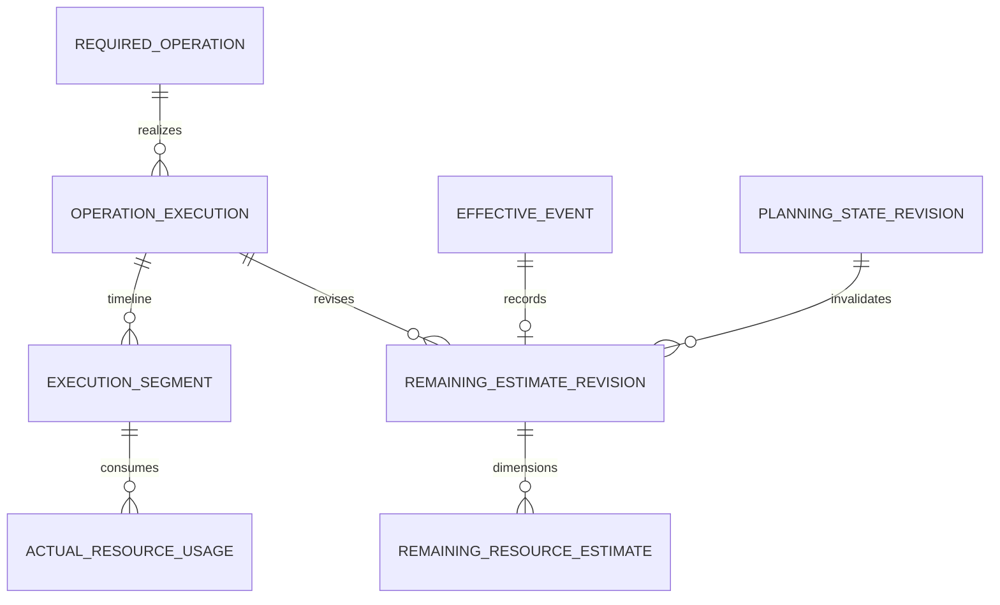

# Esquema físico PostgreSQL V1 simplificado

## 1. Estado y alcance

Este documento reemplaza como arquitectura vigente el diseño físico de 107 tablas. La V1 oficial contiene **87 tablas en 8 schemas**, de acuerdo con la auditoría pragmática aprobada.

El diseño conserva:

- planificación de capacidad finita y resultados explicables;
- personas, habilidades, recursos físicos, centros y calendarios configurables;
- rutas, fases, gates, precedencias, materiales, planos, lotes e instalación;
- escenarios aislados y programa vigente versionado;
- ejecución real y estimación restante multidimensional;
- portal público separado;
- multitenancy, auditoría e integración idempotente con Compras.

No se define SQL ni se autorizan migraciones en esta etapa.

## 2. Convenciones PostgreSQL

### 2.1 Extensiones y tipos

Se prevén `pgcrypto` para UUID/hash cuando corresponda, `btree_gist` para exclusiones mixtas y tipos nativos:

- `uuid` para identidades de negocio;
- `timestamptz` para instantes;
- `date` y `time` para reglas locales de calendario;
- `tstzrange` y `daterange` con semántica `[)`;
- `numeric` para cantidades/capacidad;
- `jsonb` solo para snapshots, parámetros tipados, explicaciones y payloads versionados;
- `bytea` para SHA-256 de 32 bytes.

Los estados estables y discriminadores físicos podrán usar enums PostgreSQL. Los catálogos de negocio configurables permanecen en tablas. Roles V1, tipos de evento y motivos de excepción son códigos cerrados y versionados por la aplicación.

### 2.2 Identidad, tenant y columnas comunes

Toda tabla tenant-owned tiene `organization_id` directo o una ruta FK inequívoca hacia organización. Las FK críticas serán compuestas cuando sea necesario para impedir referencias cruzadas. Los usuarios referencian un `auth_subject` externo; no se almacenan passwords.

Las entidades mutables usan `row_version` y baja lógica cuando corresponda. Los hechos se corrigen mediante superseding/compensación. Las soluciones `ready`, snapshots y versiones publicadas son inmutables.

### 2.3 Identificadores documentales

Los IDs `Dnnn` del diccionario se mantienen estables. Los huecos corresponden a tablas retiradas durante la simplificación y no representan objetos físicos.

## 3. Distribución física

| Schema | Tablas | Responsabilidad |
|---|---:|---|
| `core` | 10 | Tenant, planta, usuarios, clientes, proyectos, lotes e hitos |
| `capacity` | 13 | Personas, skills, recursos, centros, calendarios e indisponibilidad |
| `production` | 31 | Rutas, operaciones, materiales, planos, batches e instalación |
| `planning` | 18 | Estado operativo, escenarios, solución, asignaciones y programa publicado |
| `execution` | 5 | Hechos reales y estimaciones restantes |
| `portal` | 7 | Tokens y proyección pública segura |
| `integration` | 2 | Inbox/outbox versionados |
| `audit` | 1 | Auditoría transversal append-only |
| **Total** | **87** | |

Clasificación física exclusiva:

| Categoría | Cantidad |
|---|---:|
| Mutables, proyecciones o lifecycle técnico | 40 |
| Versionadas/lifecycle de dominio | 24 |
| Append-only o inmutables | 23 |
| **Total** | **87** |

## 4. Relaciones estructurales

### 4.1 Definición productiva

### 4.2 Capacidad y scheduling

### 4.3 Ejecución y restante

## 5. Calendarios simplificados

Planta, centro, persona y recurso físico tienen una FK directa a un calendario base. La resolución efectiva es:

1. calendario explícito del propietario;
2. para centro opcional sin calendario, calendario de planta;
3. `calendar_working_intervals` vigentes;
4. `calendar_exceptions` add/remove/replace;
5. `resource_unavailabilities` para persona o recurso;
6. `overtime_authorizations`, que habilitan pero no reservan.

No existen overlays múltiples V1. Cambiar el calendario base es un evento planificablemente relevante, incrementa `PlanningStateRevision` y queda auditado. Feriados, cierres, turnos, excepciones, ausencias y horas extra siguen representados sin ambigüedad.

## 6. Rutas, herrajes e instalación

### 6.1 Rutas y fases

Las plantillas de ruta están versionadas. Sus pasos, precedencias, fases y requerimientos son composición inmutable al publicar. Al asignar una ruta a un lote se instancian operaciones/fases/requerimientos/gates. Las operaciones instanciadas pueden ajustarse sin editar la plantilla histórica; cada cambio relevante produce una nueva `ProductDefinitionRevision`.

### 6.2 Herrajes

El lote guarda estado y disponibilidad de herrajes. Un `operation_gate` de tipo `HARDWARE_READY` referencia el lote y se aplica a una fase concreta o a la finalización.

Así se conserva:

> Prearmado → espera de herrajes → Terminación

La espera no crea trabajo. `physical_occupations` decide independientemente si el banco permanece ocupado. Los herrajes pueden impedir Terminación sin bloquear Prearmado.

### 6.3 Instalación

Instalación es una `required_operation` con `operation_kind=installation`, no una jerarquía paralela. Sus fases y requerimientos laborales permiten 1, 2 o 3 personas, duración de horas o días y equipos distintos por segmento. Usa los mismos empleados, skills, calendarios y asignaciones que producción.

`installation_lot_coverages` mantiene la relación N:M con lotes y `customer_availability_windows` limita el rango. El porcentaje se deriva de ejecución o de un evento efectivo `INSTALLATION_PROGRESS_UPDATED` y se publica solamente en la proyección allowlist.

## 7. ProductDefinitionRevision

Las tablas productivas activas son la vista editable. Publicar una definición crea `product_definition_revisions` con snapshot canónico, versión de schema/canonicalización y hash SHA-256. La planta apunta a la revisión vigente.

Cada solución referencia de forma obligatoria la revisión utilizada. Una ruta, gate, requerimiento o instalación histórica no se reinterpreta con datos actuales. Los snapshots son inmutables y no contienen información pública por defecto.

## 8. PlanningStateRevision

`planning_state_heads` tiene una fila por planta. Una transacción planificablemente relevante:

1. bloquea el head con `FOR UPDATE`;
2. calcula el siguiente número;
3. inserta una `planning_state_revision` append-only;
4. inserta eventos/auditoría y un resumen estructurado del cambio;
5. actualiza el puntero y `row_version`;
6. confirma o revierte todo.

Incrementan la revisión: calendarios, indisponibilidades, materiales, planos, herrajes, prioridades efectivas, rutas, lotes, estimaciones, ejecución, ocupación, ventanas, horas extra y eventos efectivos. El detalle por entidad se consulta desde eventos y auditoría; no existe un tercer historial duplicado.

Un escenario queda obsoleto si su versión base, revisión operativa o revisión productiva deja de coincidir con los punteros vigentes.

## 9. Ejecución y estimación restante

`operation_executions` congela `original_estimate_snapshot` y revisión productiva de origen. `execution_segments` contiene una línea temporal append-only:

- `WORK`: exige fase y puede tener usos reales;
- `PAUSE`: exige cero trabajo y motivo.

Los segmentos reales nunca se reescriben; se corrigen por superseding. Los usos reales de persona y recurso físico se guardan separados del plan.

`remaining_estimate_revisions` conserva:

- estimación original en el snapshot de ejecución;
- trabajo ejecutado al corte derivado de hechos;
- restante vigente;
- total actualizado;
- modo y valor bruto ingresado;
- evento y `PlanningStateRevision`.

`remaining_resource_estimates` mantiene por fase las dimensiones:

- `LABOR_WORK`;
- `ACTIVE_PHYSICAL_USE`;
- `PHYSICAL_OCCUPATION`.

Actualizar el restante crea hecho/revisión y luego escenario. No modifica silenciosamente el programa vigente.

## 10. Run, solución e impacto

Cada fila de `schedule_solutions` representa una ejecución completa del planificador y su único resultado V1. Conserva:

- escenario y `run_no`;
- algoritmo y parámetros;
- `ProductDefinitionRevision` y `PlanningStateRevision` de entrada;
- snapshot/hash de entrada;
- inicio/fin, diagnóstico y error;
- estado, horizonte, hash y métricas de solución;
- baseline, resumen de impacto y comparación.

Al quedar `ready` o `failed`, la fila es inmutable. Una corrida fallida conserva error sin resultados hijos. `impact_items` identifica operaciones, fases, proyectos, personas, recursos e hitos afectados y permite `COMMUNICATION_RECOMMENDED`.

Los resultados de operación/fase, asignaciones, segmentos, personas, reservas y ocupaciones siguen separados porque representan cardinalidades y restricciones diferentes.

## 11. Programa vigente, escenarios y promoción

Existe un único contexto publicado por planta. `plants.current_plan_version_id` es el puntero autoritativo; no existe `is_current`. `plan_versions.valid_during` registra historia y una exclusión por planta impide dos vigencias superpuestas.

Un escenario normal referencia:

- versión base;
- `PlanningStateRevision` base;
- `ProductDefinitionRevision` base.

El escenario inicial permite versión base null. Las hipótesis nunca actualizan estado real. Soluciones de escenarios diferentes pueden solaparse porque todas las exclusiones planificadas incluyen `schedule_solution_id`.

Promoción atómica:

1. lock `FOR UPDATE` sobre planta;
2. lock sobre `planning_state_heads`;
3. validación de `promotion_lock_version` y puntero vigente;
4. validación de revisión operativa y productiva;
5. validación de escenario, solución e invariantes contra hechos reales;
6. materialización de hipótesis aprobadas que corresponda;
7. cierre de vigencia anterior;
8. inserción de nueva `plan_version`;
9. actualización de `current_plan_version_id`;
10. `audit_entries(SCENARIO_PROMOTED)` y outbox;
11. escenario confirmado y hermanos obsoletos;
12. commit único.

Locks siempre en ese orden. Si cualquier base cambió, todo revierte y se ofrece recalcular.

## 12. Estrategia temporal y capacidad

- Rangos `[inicio, fin)` evitan doble ocupación en límites contiguos.
- GiST/EXCLUDE impide solapamiento de persona o recurso exclusivo dentro de una solución.
- `schedule_solution_id` permite que S18 y S19 contengan propuestas incompatibles entre sí.
- Las ocupaciones reales efectivas se excluyen globalmente; las planificadas, por solución.
- Capacidad `exclusive` se protege en DB; capacidad `cumulative` se valida en motor y nuevamente al promover.
- Segmentos pueden cruzar jornadas solo si la política lo permite; ocupación física puede cruzar noche sin horas-persona.
- Indisponibilidades y ventanas del cliente usan `tstzrange` con GiST.

El motor genera candidatos; PostgreSQL protege exclusividad contextual, historia y promoción.

## 13. Portal público y comunicación

El cliente accede mediante token aleatorio cuyo hash es único. Revocar/rotar conserva historia y solo un link activo por proyecto.

`public_project_projections` es una tabla pública allowlist separada de producción/planning. Guarda etapa pública, progreso, porcentaje de instalación y fecha comunicada. Las reglas internas→públicas están versionadas en mapping set/rules. Timeline y fechas comunicadas conservan historia compensatoria/append-only.

La política V1 usa calendario y umbral tipados en planta. Si una solución supera el umbral contra la fecha comunicada, crea un `impact_item` `COMMUNICATION_RECOMMENDED`. Esto no publica ni envía. La aprobación humana crea `communicated_dates`, actualiza la proyección, audita y recién entonces puede emitir outbox.

RLS/privilegios futuros darán al rol público acceso solo a funciones/vistas de proyección filtradas por token; jamás a tablas internas.

## 14. Seguridad, multitenancy e integración

- `organization_id` o cadena FK tenant-safe en toda entidad.
- Roles V1 cerrados: admin, planner, supervisor, operator y portal-service; permisos allowlist.
- `auth_subject` externo compatible con Supabase Auth o equivalente.
- FK tenant-owned compuestas donde una FK simple no garantice ownership.
- Snapshots/soluciones Ready sin UPDATE para roles normales.
- Audit/outbox/inbox con permisos separados.

Compras permanece desacoplado por API y eventos versionados. Inbox asegura idempotencia `(source_system,idempotency_key)`; outbox publica solo después del commit de dominio. Nunca se comparten tablas entre aplicaciones.

## 15. Registro de 68 constraints relevantes

No incluye PK, FK ni `NOT NULL` básicos.

| ID | Regla física o transaccional |
|---|---|
| C01 | Slug de organización único y normalizado |
| C02 | Código de planta único por organización |
| C03 | `auth_subject` único; no password local |
| C04 | Asignación usuario/role/planta sin vigencias superpuestas equivalentes |
| C05 | Código de proyecto único por organización |
| C06 | Rank/código de prioridad únicos y un default parcial por organización |
| C07 | Código y secuencia de lote únicos por proyecto |
| C08 | Proyecto requiere al menos un lote antes de entrar a producción |
| C09 | Código de hito único y hechos corregidos solo por superseding |
| C10 | Código de empleado único por planta y user profile no duplicado |
| C11 | Habilidad habilitada no solapada por empleado/skill/vigencia |
| C12 | Código de tipo de recurso único por organización |
| C13 | Código de recurso único por planta y capacidad positiva |
| C14 | Grupo y miembros pertenecen a la misma planta; membresía única |
| C15 | Intervalos de calendario válidos, factor positivo y reglas no ambiguas |
| C16 | Calendario base de planta/centro/persona/recurso pertenece al mismo tenant |
| C17 | Indisponibilidad tiene exactamente un owner y rango no vacío |
| C18 | Hora extra tiene scope, rango, aprobación y minutos válidos |
| C19 | Versión de ruta única e inmutable al publicar |
| C20 | Paso/fase template únicos por versión y secuencia |
| C21 | Grafo de ruta sin self ni ciclos al publicar |
| C22 | Una asignación de ruta activa por lote |
| C23 | Operación requerida única por proyecto/lote/código y kind permitido |
| C24 | Fase requerida única y al menos una fase al publicar |
| C25 | Precedencia sin self, arista activa única y DAG válido |
| C26 | Gate con timing y exactamente un target coherente; herraje apunta a lote |
| C27 | Requerimiento laboral con `1≤min≤max` y trabajo no negativo |
| C28 | Requerimiento físico con selector válido y cantidades positivas |
| C29 | Revisión productiva única por planta/número/hash, snapshot objeto e inmutable |
| C30 | Versión de batch y miembro por fase únicos; composición publicada inmutable |
| C31 | Requerimientos y líneas de material con cantidad/unidad válidas |
| C32 | Proveedor/pedido externo único cuando exista referencia |
| C33 | Entrega externa idempotente; línea/movimiento válidos |
| C34 | Asignación material no supera recepción neta, mediante lock transaccional |
| C35 | Liberación de plano única por paquete e inmutable publicada |
| C36 | Coverage/ventana apuntan a operación `installation`; porcentaje/rango válidos |
| C37 | Una fila de state head por planta, bloqueable y no eliminable |
| C38 | Revisión operativa única por planta/número/transacción; append-only |
| C39 | Evento con código/schema allowlist, payload válido y clave externa idempotente |
| C40 | Excepción manual tiene scope, código/motivo, aprobación y rango coherentes |
| C41 | Planning lock tiene scope coherente e historia de liberación |
| C42 | Número de versión de plan único por planta; filas inmutables |
| C43 | Vigencias publicadas no se superponen y Current referencia misma planta |
| C44 | Bases del escenario pertenecen a planta/tenant; base plan null solo en initial |
| C45 | Transiciones de escenario válidas y escenarios stale no promovibles |
| C46 | Hipótesis única por escenario; no modifica estado real |
| C47 | Run/solución único por escenario/número; hashes válidos e inmutabilidad final |
| C48 | Impact item tiene al menos un target y código de impacto permitido |
| C49 | Resultado único por solución/operación; blocked/out-of-horizon sin asignación permitidos |
| C50 | Resultado único por solución/fase y coherente con operación padre |
| C51 | Asignación apunta exactamente a phase result o batch version |
| C52 | Segmento único, rango válido, dentro de horizonte y minutos no negativos |
| C53 | Persona única por segmento y no solapada dentro de solución |
| C54 | Recurso único por segmento; exclusivo no solapado dentro de solución |
| C55 | Ocupación tiene fuente solución o ejecución; exclusión contextual/real correcta |
| C56 | Hito único por solución/proyecto/definición |
| C57 | Ejecución conserva revisión/original y referencias de origen coherentes |
| C58 | Segmento WORK/PAUSE con fase, trabajo y motivo coherentes |
| C59 | Uso real apunta exactamente a persona o recurso y solo a segmento WORK |
| C60 | Revisión restante secuencial, única vigente, fórmula y valores no negativos |
| C61 | Detalle restante coherente con `LABOR_WORK`/`ACTIVE_PHYSICAL_USE`/`PHYSICAL_OCCUPATION` |
| C62 | Token hash de 32 bytes único y un enlace activo por proyecto |
| C63 | Mapping set/rules versionados con prioridad/regla únicas |
| C64 | Proyección pública única por proyecto, allowlist y porcentajes 0–100 |
| C65 | Fecha comunicada append-only, aprobada y corregida por superseding |
| C66 | Inbox único por fuente/idempotency key; payload/hash inmutables |
| C67 | Outbox único por tenant/logical key; payload inmutable y estado técnico válido |
| C68 | Auditoría append-only; acción/actor/transacción coherentes y datos minimizados |

## 16. Registro de 28 familias de índices secundarios

No cuenta índices automáticos de PK, UNIQUE o EXCLUDE.

| ID | Consulta / índice |
|---|---|
| I01 | Proyectos activos por planta/prioridad/fecha comprometida |
| I02 | Lotes por proyecto/secuencia |
| I03 | Operaciones por lote/estado |
| I04 | Fases pendientes por estado/earliest start |
| I05 | Precedencias por predecesora y sucesora |
| I06 | Gates pendientes por target/timing |
| I07 | Material pendiente por lote/needed_at |
| I08 | Entregas y allocations por requerimiento |
| I09 | Empleados por centro/estado |
| I10 | Recursos por centro/tipo/estado |
| I11 | Indisponibilidades GiST por owner/rango |
| I12 | Excepciones de calendario por calendario/fecha |
| I13 | Escenarios por planta/base/status |
| I14 | Escenarios potencialmente stale por tres bases |
| I15 | Soluciones por escenario/run/status |
| I16 | Resultados bloqueados por solución/recurso crítico |
| I17 | Segmentos planificados GiST por rango y solución |
| I18 | Personas planificadas por empleado/inicio |
| I19 | Reservas físicas por recurso/inicio |
| I20 | Ocupaciones activas por recurso y GiST rango |
| I21 | Ejecuciones activas por operación/status/inicio |
| I22 | Segmentos reales por ejecución/rango |
| I23 | Usos reales por persona/recurso/rango |
| I24 | Estimación restante vigente parcial por ejecución |
| I25 | Eventos por entidad/effective_at y por revisión |
| I26 | Token público por hash/estado |
| I27 | Inbox por estado/received_at y outbox pendiente por available_at |
| I28 | Auditoría por entidad/fecha y actor/fecha |

Los planes reales de consulta decidirán si un índice de exclusión GiST ya cubre un lookup y evita duplicarlo.

## 17. Revalidación de las 45 invariantes

| Invariante | Estrategia física simplificada |
|---|---|
| INV-01 | Proyecto/lote y transición diferida C07–C08 |
| INV-02 | Route version publicada inmutable C19 |
| INV-03 | DAG de ruta C21 |
| INV-04 | Precedencia instanciada C25 + ejecución/motor |
| INV-05 | Gate tipado C26; herraje en lote sin bloquear fase anterior |
| INV-06 | EXCLUDE solución/persona/rango C53 |
| INV-07 | EXCLUDE recurso exclusivo C54; cumulative en motor |
| INV-08 | Ocupación contextual/real C55 y revalidación al promover |
| INV-09 | Calendario base directo, intervalos/excepciones/unavailability C15–C18 |
| INV-10 | Skill vigente C11 y validación temporal del motor |
| INV-11 | Equipo/recurso C27–C28 y simultaneidad en motor |
| INV-12 | Resultados únicos C49–C50 |
| INV-13 | Estado `out_of_horizon` diferenciado C49 |
| INV-14 | Solución final inmutable C47 y permisos DB |
| INV-15 | Current en planta + vigencia EXCLUDE C42–C43 |
| INV-16 | Locks y comparación de tres bases C37–C45 |
| INV-17 | Escenario/solución no actualizan versión; solo promoción |
| INV-18 | Ejecución append-only/superseding C57–C59 y PlanningLock |
| INV-19 | Hora extra autorizada C18 y FK desde asignación |
| INV-20 | Allocation material transaccional C31–C34 |
| INV-21 | Inbox/entrega idempotentes C33/C66 |
| INV-22 | Gate de Terminación por herrajes C26 |
| INV-23 | Link activo único C62 |
| INV-24 | Proyección allowlist/RLS C64 |
| INV-25 | Recomendación D074; aprobación D097; outbox solo posterior C65/C67 |
| INV-26 | Mínimo una fase y suma validada C24/C27 |
| INV-27 | Fases y gates secuenciales C24–C26 |
| INV-28 | Trabajo solo en WORK; ocupación separada C55/C58 |
| INV-29 | Snapshot/hash canónico C29 y FK desde solución |
| INV-30 | Solución referencia revisiones productiva/operativa C47 |
| INV-31 | Hipótesis aislada C46 |
| INV-32 | Excepción manual tipada, scoped y aprobada C40 |
| INV-33 | Comparación O(1) de punteros/revisiones; stale C43–C45 |
| INV-34 | Origen de ejecución opcional/coherente C57 |
| INV-35 | Batch version/miembros C30 y resultado compartido C51 |
| INV-36 | Mapping versionado y regla aplicada C63–C64 |
| INV-37 | State head bloqueado y revisión única C37–C39 |
| INV-38 | Original congelado en ejecución; remaining no lo sobrescribe C57/C60 |
| INV-39 | Ejecutado deriva de WORK/usos append-only C58–C59 |
| INV-40 | Corte/raw input/fórmula de restante C60 |
| INV-41 | Secuencia y único restante vigente C60 |
| INV-42 | Restante enlaza evento/revisión; promoción separada C60 |
| INV-43 | Dimensiones de restante coherentes C61 |
| INV-44 | Locks/hechos ejecutados; solución solo recalcula futuro |
| INV-45 | Rechazo cambia escenario, no Current ni restante efectivo |

Cobertura: **45/45 invariantes preservadas**.

## 18. Revalidación de los 44 casos de aceptación

| Casos | Resultado físico |
|---|---|
| CA-01–CA-05 | Personas/máquinas simultáneas, material, precedencia y lotes representables |
| CA-06–CA-10 | Horas-persona, ocupación nocturna, bancos, descarga y perforadora representables |
| CA-11–CA-13 | Instalación tipada, equipo variable y horas extra representables |
| CA-14–CA-17 | Ejecución congelada, escenario aislado, promoción y stale representables |
| CA-18–CA-21 | Prioridad, batch compartido, explicación y reproducibilidad representables |
| CA-22–CA-24 | Proyección segura, rotación de link e inbox idempotente representables |
| CA-25–CA-29 | Fases/herrajes, simultaneidad, bancos, jornadas y horizonte representables |
| CA-30–CA-36 | Hitos, comunicación derivada, origen, stale, hipótesis, snapshot y mapping representables |
| CA-37–CA-44 | Demora/adelanto, restante simple, conflicto, fechas, ocupación, historia y rechazo representables |

Cobertura: **44/44 casos representables**.

## 19. Casos difíciles, UX y comandos

Los 22 casos difíciles se revalidan por grupos:

- CD-01–05: gates, ocupación, bancos, equipo y ventanas;
- CD-06–10: allocation, inbox, rutas, batches y horizonte;
- CD-11–15: stale, concurrencia, locks, overtime y skills;
- CD-16–18: indisponibilidad, comunicación y link;
- CD-19–22: proyección, corrección real, timezone y publicación atómica.

Cobertura: **22/22 preservados**.

UX-01 a UX-10 continúan soportados mediante D089/D090, escenario/hipótesis, solución/impactos, asignaciones contextuales, Current por planta y promoción atómica. Cobertura: **10/10**.

Los comandos `UPDATE_REMAINING_ESTIMATE`, `RESIZE_SCHEDULED_ACTIVITY`, `MOVE_SCHEDULED_ACTIVITY`, `REPLAN_FROM_OPERATION`, `REPLAN_PROJECT`, `ACCEPT_REPLAN` y `REJECT_REPLAN` permanecen en la capa de aplicación. La interfaz nunca manipula directamente segmentos, reservas, escenarios, locks o revisiones. Cobertura: **7/7**.

## 20. Riesgos residuales

- Capacidad acumulativa depende de motor y revalidación transaccional.
- Códigos de rol/evento/excepción requieren contratos de aplicación versionados.
- Un calendario base por owner no cubre overlays múltiples; se difieren.
- Un run produce una solución V1; multi-solución requerirá separar cabecera.
- Una planta tiene un único programa publicado; multi-plan se difiere.
- Historia pública exacta por snapshot depende de auditoría/timeline, no de tabla especializada.
- Calidad de explicación depende de diagnóstico estructurado del motor.
- Índices finales deberán verificarse con `EXPLAIN` y volumen real.

## 21. Decisiones diferidas

- Roles personalizados por organización.
- Overlays/múltiples calendarios simultáneos por owner.
- Entidad especializada de herrajes por componente.
- Subtipo/paquete de instalación con metadata propia.
- Detalle indexable por entidad de cada state revision.
- Tipos de evento y motivos de excepción administrables por tenant.
- Múltiples programas publicados por planta.
- Relación N:M arbitraria entre escenario y eventos.
- Varias soluciones por run o varios análisis por solución.
- Workflow avanzado/versionado de comunicación y snapshots públicos legales.
- Tabla especializada de promociones si auditoría general resulta insuficiente.

## 22. Conclusión

El esquema simplificado mantiene las distinciones de dominio, la capacidad finita, temporalidad contextual, versionado, reprogramación, portal seguro, integración y concurrencia. Tiene 87 tablas, 68 familias de constraints relevantes y 28 familias de índices secundarios explícitos.

La conclusión formal se emite en `docs/11-cierre-esquema-fisico-v1.md`; este documento por sí solo no autoriza migraciones.

## Extensión M11 — Ubicación de instalación V1

V1 soporta una ubicación principal de instalación por proyecto. M11 agrega seis
columnas text nullable a core.projects: nombre del sitio, dirección, localidad,
contacto, teléfono e indicaciones de acceso. Dirección y localidad se validan en
readiness de instalación; no se exige backfill a proyectos históricos o sin
instalación. Se conservan 8 schemas y 87 tablas. M0–M10 históricos intactos.
Múltiples sitios por proyecto requerirían entidad installation_sites; no se implementa.
