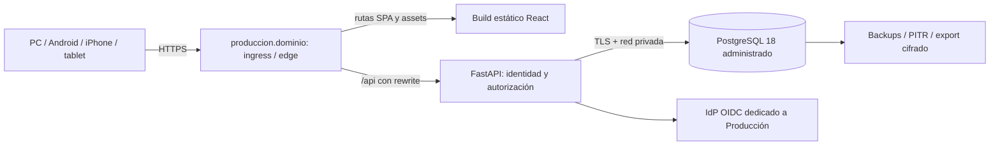

# Etapa 8 — Auditoría de preparación cloud

Fecha: 2026-10-29, America/Buenos_Aires. Alcance: auditoría y planificación.
Directorio exclusivo: `C:\Users\BESTEN-01\Documents\ChatGPT\Produccion Besten`.
Branch `master`, HEAD `df97bebe61a772ec79717b4b52c07cdd6f24e815`.

**Auditoría completada; aplicación todavía NO habilitada para Internet.**
Esta conclusión no es una autorización para desplegar. No se creó ningún
servicio cloud, cuenta, DNS, backup/export, migración, usuario, revisión,
simulación ni plan. No se modificó autenticación ni lógica. El único archivo
creado por esta etapa es este informe. El avance V2/colorimetría pendiente se
preserva. App de Compras y backup recuperado no se acceden ni modifican.

## 1. Resultado ejecutivo y gates

La aplicación puede evolucionar a una SPA HTTPS con FastAPI permanente y
PostgreSQL administrado, sin depender de BESTEN-01. Las 87 tablas y ocho schemas
no constituyen un impedimento por cantidad. Los principales gates son:

1. Identidad verificable y autorización backend: actualmente sólo hay contexto
   DEV confiado al navegador. No publicar habilitando DEV como workaround.
2. Build/routing de producción reproducible y separado de Vite DEV.
3. PostgreSQL privado, TLS verificado, permisos runtime reconstruibles y restore
   comprobado. La configuración local actual no se traslada tal cual.
4. Corregir el runner de migraciones antes de provisionar una base nueva:
   dos scripts esperan 12 archivos, pero existen 14, M0–M13.
5. Resolver el shell HTML móvil: falta meta viewport. Las pruebas a 390 px
   actuales usan viewport desktop, no emulación móvil ni Safari real.
6. Backup/PITR, observabilidad, release controlado y staging antes del corte.

**Estado real observado:** A685 activo, REV 4 congelada/liberada, ocho escenarios;
**CURRENT ya existe, V1 publicado**. No se utiliza como premisa el CURRENT vacío
de informes anteriores. Véase sección 17 para IDs y comprobaciones.

## 2. Método, evidencia y límites

Se inspeccionaron fuentes, manifests/locks, configuración, SQL M0–M13,
scripts operativos, documentación previa y pruebas existentes. Se consultaron
catálogos PostgreSQL y datos mediante conexiones con
`default_transaction_read_only=on`, usando el rol runtime existente. Se tomó un
baseline de conteos y SHA-256 por tabla en transacción repeatable-read/read-only.
No se leyeron pgpass.conf, .env privados, pg_hba.conf ni passwords; no se
imprimió DATABASE_URL. No se inspeccionaron otras aplicaciones ni backups.

Se verificó la factory en un TestClient sin listener público, motor read-only y
contexto DEV deshabilitado: `/health` 200, `/ready` 200 y `/projects` 503
`AUTH_PROVIDER_NOT_CONFIGURED`, incluso aportando los headers DEV. No se
ejecutaron suites completas, análisis de CVE, pentest, restore ni publicación.
La evaluación móvil usa evidencia estática y E2E previos; no certifica teléfonos
reales. No se comprobó firewall externo ni exposición real a Internet.

Fuentes externas son documentación oficial, consultada el 2026-10-29. Costos,
regiones y planes deben reconfirmarse antes de contratar. Las propuestas de
roles, sesiones, capacidad, presupuesto y recuperación no están aprobadas.

### Referencias de código verificadas

| Evidencia | Fuente del repositorio |
| --- | --- |
| Factory, DEV y routers | `src/production_besten/api/app.py` |
| Headers e identidad no verificada | `api/dependencies.py`, `api/context.py` bajo `src/production_besten/` |
| Configuración y pool | `infrastructure/settings.py`, `persistence/database.py` |
| Errores, health/readiness | `api/errors.py`, `api/routes.py`, `persistence/api_queries.py` |
| Cliente y ruta API | `frontend/src/api/client.ts`, `frontend/vite.config.ts` |
| SPA, HTML y pruebas de viewport | `frontend/src/main.tsx`, `frontend/index.html`, `frontend/playwright.config.ts` |
| Modelos de roles/RLS prevista | `db/migrations/000_extensions_schemas_types.sql`, `001_core_identity.sql`, `docs/19-plan-rls-v1.md` |
| Permiso operativo esencial | `db/operations/editor_audit_result_permission.sql` |
| Runner desactualizado | `db/verify/apply_with_psql.ps1`, `db/verify/static_verify.ps1` |

## 3. Arquitectura actual

### Frontend

SPA React/TypeScript con React Router y React Query. Versiones del lock:
React/React DOM 19.3.0, React Router 8.4.0, React Query 5.103.2, Vite 8.3.0,
TypeScript 5.9.3, Playwright 1.63.0. Node observado: 24.22.1. React Router exige
Node >=22.22.0; elegir la imagen de build considerando todas las dependencias,
no sólo Vite. `package.json` usa muchos `latest`, aunque `package-lock.json`
resuelve versiones: usar `npm ci`, no una resolución nueva durante el deploy.

Build: `npm run build` ejecuta TypeScript y Vite; salida `frontend/dist`.
El último build documentado tiene JS ~1,29 MB / ~206 KB gzip y warning de chunk
grande. No es un impedimento técnico al hosting, pero merece medición móvil.
No hay SSR ni servidor Node de aplicación necesario después del build.

Todas las llamadas usan `fetch('/api' + path)`. Vite DEV redirige `/api` a
`http://127.0.0.1:8000`, eliminando ese prefijo. No existe VITE_API_BASE_URL ni
routing cloud. El build estático no incorpora el proxy de Vite. Los únicos
VITE de identidad usados por el cliente son VITE_DEV_USER_ID,
VITE_DEV_ORGANIZATION_ID y VITE_DEV_PLANT_ID, con fallback a localStorage.
Se envían en X-Dev-*; no son secretos, pero tampoco pruebas de identidad.

Rutas SPA: `/`, `/projects`, `/projects/new`, `/projects/:projectId`,
`/projects/:projectId/product-definition`, `/operations/:operationId`,
`/installations`, `/planning/gantt`, `/settings`. Requieren fallback a index.html
en navegación directa/recarga. `/api/*` nunca debe caer en ese fallback.
No se encontró manifest PWA, service worker, offline ni sincronización offline.
No se propone PWA en esta etapa.

### Backend

Python observado 3.11.9; paquete >=3.11. Lock/entorno observado:
FastAPI 0.141.1, Uvicorn 0.52.4, SQLAlchemy 2.0.52, psycopg 3.3.5,
Pydantic 2.13.5, Starlette 1.6.0, tzdata 2026.3. Hay requirements.lock,
pero mezcla runtime, build y tests y no fija hashes de artefactos.

`create_app()` lee Settings si no recibe engine. APP_ENV predeterminado es
`production`; sólo development/testing habilitan DEV. Inyectar un engine habilita
DEV por defecto; además existe override `enable_dev_context`. Las factories
productivas deberán impedir explícitamente ese bypass de configuración.

Settings sólo consume DATABASE_URL y APP_ENV. No carga .env automáticamente
(`env_file=None`). SQL_ECHO figura en .env.example pero no está modelada ni usada;
no hay echo SQL habilitado en create_database_engine. Un valor nuevo en el
environment no implementa por sí solo una capacidad de configuración.

El pool actual sólo configura pool_pre_ping; no hay límites/timeout propios.
No hay middleware CORS, seguridad de headers, sesión, CSRF o rate limit.
Tampoco static files/SPA dentro de FastAPI. Hay 70 operaciones HTTP de negocio y
sistema en el OpenAPI inspeccionado; no es un login ni un gateway productivo.

`/health` es liveness sin DB. `/ready` ejecuta SELECT 1; no valida permisos de
escritura, versión de schema, identidad ni recuperación. Puede estar verde aunque
el negocio responda 503 por falta de IdP. Un error de conexión en readiness cae
en handler 500 genérico; falta estado operativo más específico y timeout acotado.

Handlers traducen IntegrityError a 409 genérico y excepciones inesperadas a 500
genérico. Los errores de dominio usan str(exc). Hay saneamiento adicional en el
cliente; no sustituye revisar errores backend antes de Internet. FastAPI no
activa debug en esta factory. Docs/OpenAPI quedan con defaults, sin protección
específica. No se encontraron logs estructurados/redacción centralizada; Uvicorn
aporta access/error logs. El cliente registra método/path/status/code, sin body,
pero los paths pueden contener identificadores internos.

Los endpoints son mayormente síncronos y las simulaciones ocurren en el request;
no hay worker/cola de jobs implementado. La consistencia usa transacciones,
locks PostgreSQL, revisiones e idempotencia, no un estado de plan en memoria.
No hay persistencia de negocio basada en archivos Windows o disco local.

### Base de datos

PostgreSQL 18.6, `produccion_besten`, tamaño observado 17.356.479 bytes (~16,55 MiB),
no un dimensionamiento de RAM/WAL/backups. Ocho schemas: core, capacity,
production, planning, execution, portal, integration, audit; 87 tablas.
Extensiones instaladas: pgcrypto 1.4, btree_gist 1.8 y plpgsql 1.0.
M0–M13 son 14 SQL transaccionales; M11–M13 no agregan tablas.

Rol `produccion_besten_app`: LOGIN, no superuser, CREATEDB, CREATEROLE,
REPLICATION ni BYPASSRLS; no CREATE en DB ni en los ocho schemas. Propietario de
schemas: postgres. SELECT sobre 87 tablas; INSERT sobre 79 y UPDATE general
sobre 77. DELETE sólo en capacity.calendar_working_intervals y
production.operation_labor_requirements. audit.audit_entries permite INSERT,
SELECT y UPDATE **de la columna after_data**; no UPDATE general ni DELETE.
No se presume que estos permisos sean la política final de producción.

RLS/force RLS: 0 de 87 tablas. La protección actual usa filtros tenant y FK
compuestas; hay tests de aislamiento, pero el tenant solicitado no está ligado
a una identidad autenticada. RLS futura es defensa adicional, no reemplazo del
control backend; no se activa parcialmente durante este informe.

Configuración observada vía SQL: ssl=off, listen_addresses='*'. No prueba
exposición a Internet: firewall/pg_hba/red no se auditaron. Sí impide copiar esa
configuración sin cambios a una DB cloud. El rol runtime no debe ser dueño,
administrador ni la cuenta de migración.

## 4. Inventario de dependencias locales

| Dependencia / ubicación | Clasificación | Tratamiento propuesto |
| --- | --- | --- |
| 127.0.0.1:8000 en vite.config.ts | DEV solamente | Reemplazar en PROD por routing de ingress; no levantar Vite DEV |
| `fetch('/api…')` | No representa problema con same-origin; requiere routing | Conservar mecanismo y documentar prefijo/rewrite |
| :5173 y :4173 | DEV / tests | No son servicios productivos |
| APP_ENV development/testing | Bloquea producción si se publica así | APP_ENV production y verificación de fallo cerrado |
| X-Dev-* / VITE_DEV_* / localStorage | Bloquea producción | Sustituir por sesión verificable; no aceptar IDs arbitrarios |
| Maximiliano y UUID reales | Datos, no problema de portabilidad | Preservar UUID; vincular a identidad verificada, no hardcodear en frontend |
| DATABASE_URL local | Debe parametrizarse; secreto backend | Secret store, endpoint privado y TLS verificado |
| pgpass local | DEV solamente | No copiar a imagen/repo; credencial cloud separada |
| Windows .venv/Scripts en api:generate | Debe parametrizarse para CI | Python de build portable; no copiar .venv |
| PowerShell/db\\migrations en scripts | DEV / provisionamiento a preparar | Runner portable con manifiesto M0–M13, permisos y ledger |
| Conteo fijo 12 en dos scripts | Bloquea provisionamiento actual | Corregir en fase A; actualmente hay 14, no ejecutar tal cual |
| test_postgres_disposable.py localhost/postgres | DEV/tests | Sólo test aislado con rol de creación; nunca URL PROD |
| export_openapi.py engine localhost | DEV/build | Construye schema sin conectar; desacoplar dependencia conceptual de host y DEV |
| smoke_customer_ui.py exige host local y DB descartable | DEV solamente | Mantener protección, no adaptarlo para mutar PROD |
| Instalar truststore por Windows | DEV | Build Linux con CA confiables; no deshabilitar TLS |
| Dist/node_modules/cache locales | No representa persistencia de negocio | Reconstruir en CI, nunca subir como dump de la PC |
| Timezone de sistema de BESTEN-01 | Debe independizarse | Servidor UTC; semántica/visualización por zona IANA de planta |
| Calendar America/Argentina/Cordoba | No representa problema | Preservar datos y tzdata; no usar hora del servidor para date-only |

## 5. Riesgos de seguridad y preparación

BLOCKER = no abrir negocio a Internet hasta resolverlo. HIGH = requisito de
salida o mitigación explícita aprobada. MEDIUM/LOW = hardening/operación. No se
afirma exploit, CVE, fuga ni exposición remota no comprobados.

| Nivel | Hallazgo comprobado o brecha | Gate / mitigación futura |
| --- | --- | --- |
| BLOCKER | Identidad DEV suplantable si se habilita públicamente; production responde 503 | Login verificable, rechazo X-Dev-* y pruebas negativas |
| BLOCKER | Sin autorización por usuario/rol/planta; capabilities sin enforcement y cero memberships reales | Política default-deny para toda ruta de negocio |
| BLOCKER | No hay ruta productiva /api ni configuración HTTPS de aplicación | Ingress HTTPS, rutas SPA/API diferenciadas, secrets |
| HIGH | Migración genérica detenida por conteo 12 vs 14; permisos runtime fuera de M0–M13 | Runner versionado probado en DB nueva; receta de grants |
| HIGH | TLS DB local off, listener amplio, red cloud no definida | DB privada, reglas de red, verify-full/CA del proveedor |
| HIGH | No hay backup/restauración cloud comprobados | Restore ensayo y política RPO/RTO antes del corte |
| HIGH | Sin rate limit, cuotas ni límites operativos específicos de simulación | Rate limit por identidad/tenant y presupuesto de cómputo/timeout |
| HIGH | Sin sesión productiva, CSRF ni recuperación de acceso | Diseñar conjunto IdP/BFF/cookies/CSRF, no parches aislados |
| HIGH | Falta meta viewport y cobertura móvil real | HTML móvil mínimo + Android/iOS/WebKit; ninguna pantalla certificada para teléfono todavía |
| HIGH | No hay pipeline/release/provisión reproducible ni pruebas Linux de permisos | CI, artefacto inmutable, staging y promoción manual |
| MEDIUM | No hay RLS adicional | Backend privado con tests tenant; decidir RLS integral posteriormente |
| MEDIUM | Sin security headers, allowed hosts ni control de forwarded headers propio | CSP probada, nosniff, referrer policy, frame-ancestors, HSTS tras TLS |
| MEDIUM | Logging sin request-id/redacción central; errores de dominio textuales | Sanitizar en servidor, logs privados, no cuerpos/credenciales/tokens |
| MEDIUM | Readiness sólo SELECT 1 y sin chequeo de schema/auth | Gates de arranque; distinguir liveness/readiness/negocio |
| MEDIUM | Locks/deps mixtos, latest en manifests, sin análisis de dependencias | npm ci, pinning, lock runtime, análisis SCA; no CVE inventadas |
| MEDIUM | Bundle grande y sin validación en conexiones móviles reales | Compresión/CDN, medición; no cambiar Gantt en esta auditoría |
| LOW | Docs/OpenAPI por defecto y shell HTML sin title/lang explícitos | Restringir docs según política; mejorar metadatos/a11y |

No se encontró middleware CORS abierto con wildcard: **CORS está ausente**.
Con same-origin es válido no necesitarlo. CORS no autentica ni impide que un
cliente HTTP externo envíe requests. Tampoco se encontró un token de sesión en
localStorage: los valores actuales son IDs DEV, no credenciales de login.

## 6. Arquitectura objetivo recomendada

Recomendación de arquitectura, independiente del proveedor:



Preferir **same-origin** `https://produccion.<dominio>/api` para el piloto:
conserva el cliente relativo, simplifica cookies y evita CORS entre SPA/API.
El ingress elimina /api hacia el backend, mantiene rutas API fuera del fallback
SPA y bloquea acceso público directo que evada sus controles. No exige un proxy
Vite ni que la PC esté encendida. La CDN puede cachear sólo assets públicos.

Alternativa: `https://api-produccion.<dominio>` separado. Permite ciclos y
escalado independientes, pero requiere URL API configurada, CORS exacto,
credentials y política de cookies/CSRF más cuidadosa. Subdominios distintos son
cross-origin aunque puedan ser same-site: no confundir ambos conceptos.

No existe hoy ingress, static serving o CORS cloud en el repo. Si la plataforma
no ofrece un routing same-origin adecuado, deberá elegirse entre configurar un
edge/reverse proxy o adoptar explícitamente la alternativa de dos orígenes.
No se crea ninguno ahora.

### Comparación de proveedores, sin adjudicación

| Candidato | Ventaja para este caso | Tradeoff y verificación pendiente |
| --- | --- | --- |
| AWS: RDS PostgreSQL + contenedor administrado/CDN | Opción regional São Paulo, red privada y herramientas de backup; PostgreSQL 18 y extensiones documentados | Más componentes/IAM/operación y cotización regional; probar plan, CA, extensiones, restore y latencia juntos |
| Render pago: web/static + Postgres | Operación integrada, PostgreSQL 18 y PITR en planes pagos | Regiones documentadas sin Sudamérica; comparar latencia desde Argentina. PITR depende del plan; Hobby 3 días no cumple propuesta de 7 |
| DigitalOcean: app/compute + Managed PostgreSQL | PG18/extensiones documentadas y precio inicial visible | Tabla regional consultada sin São Paulo; comparar latencia y disponibilidad del producto concreto, PITR/retención y condiciones actuales del plan |

La preferencia geográfica es app y DB juntas en una región cercana a Argentina;
São Paulo es candidata, no una compra aprobada. Si prima facilidad operativa,
evaluar PaaS pago con medición real de latencia. No dividir app y DB entre
proveedores/regiones por ahorrar una tarifa mínima sin medir TCO y seguridad.

Costo: no se fija un total sin región, HA, concurrencia, IdP ni política de
recuperación aprobados. DigitalOcean publica base desde USD 15/mes para nodo
simple de 1 GiB, orientado a desarrollo/pruebas; **no es cotización del sistema
ni equivale a HA**. Sumar backend permanente, staging, almacenamiento/backups,
egress, logs, IdP/correo de recuperación, dominio e impuestos. RDS requiere
cotización por región/instancia/almacenamiento; no se inventa precio Render
cuando su tabla dinámica no ofrece un total verificable en esta lectura.
Solicitar tres presupuestos equivalentes por 730 h/mes y alertas de gasto.
No usar bases de expiración ni servicios que duerman para operación permanente.

Fuentes: [AWS regiones PG18](https://docs.aws.amazon.com/AmazonRDS/latest/UserGuide/Concepts.RDS_Fea_Regions_DB-eng.Feature.MultiAZDBClusters.html),
[RDS extensiones](https://docs.aws.amazon.com/AmazonRDS/latest/UserGuide/PostgreSQL.Concepts.General.FeatureSupport.Extensions.html),
[RDS precios](https://aws.amazon.com/rds/postgresql/pricing/),
[Render regiones](https://render.com/docs/regions),
[Render PG18](https://render.com/docs/postgresql-creating-connecting),
[Render PITR](https://render.com/docs/postgresql-backups),
[límites free](https://render.com/docs/free),
[DO regiones](https://docs.digitalocean.com/platform/regional-availability/),
[DO extensiones](https://docs.digitalocean.com/products/databases/postgresql/details/supported-extensions/),
[DO precios](https://docs.digitalocean.com/products/databases/postgresql/details/pricing/).

## 7. Identidad, tenancy y autorización propuestas

No implementar passwords propios. Preferir un IdP OIDC administrado con login,
recuperación, bloqueo de intentos y MFA. Flujo propuesto: Authorization Code +
PKCE, callback backend, validación de issuer/audience/firma/exp/nonce/state y
sesión BFF opaca. Guardar tokens del proveedor en servidor, no en localStorage.

Cookie propuesta: host-only, Secure, HttpOnly, SameSite=Lax, Path=/, nombre
__Host-… cuando cumpla requisitos. TTL absoluto 8 h e inactividad 30 min son
valores iniciales **a aprobar**; rotar sesión al login/cambio de privilegios y
revocar al logout, baja, expiración o recuperación. Sesiones deben compartirse
entre workers (store persistente), no memoria de un proceso. Agregar CSRF token
y validación Origin/Referer para mutaciones; SameSite no es defensa única.
Recuperación mediante proveedor con canal real aprobado y tokens de un uso;
MFA obligatoria propuesta para administración/planificación sensible.

Maximiliano existe con auth_subject `dev:maximiliano` y email NULL; no se puede
asumir que ya sea una cuenta recuperable. Vincular su UUID actual a un subject
verificado mediante procedimiento administrativo trazable. No enlazar cuentas
por email enviado por el cliente ni inventar email/teléfono. El identificador
debe incluir semántica de issuer/subject; evaluar unicidad compatible.

El backend resuelve sesión → perfil activo → memberships vigentes → organización
y plantas autorizadas → capacidades. El frontend puede solicitar una planta de
su lista permitida, pero el servidor valida pertenencia en cada request y no
acepta user_id/organization_id arbitrarios. El actor de auditoría proviene de la
sesión verificada. Rechazar o ignorar explícitamente X-Dev-* en PROD y eliminar
su uso en el cliente productivo; un UUID conocido no autoriza acceso.

Hay cero filas en core.user_roles. El enum actual contiene admin, planner,
supervisor, operator, portal_service: no corresponde exactamente con los cinco
roles candidatos del usuario. La matriz siguiente es una propuesta, no el enum
final; puede requerir una migración acotada y pruebas para roles/capacidades/
sesiones una vez aprobada. No mezclar portal_service con personas operadoras.

| Rol candidato no aprobado | Lecturas | Mutaciones propuestas |
| --- | --- | --- |
| ADMINISTRADOR | Organización/plantas autorizadas | Usuarios/permisos, maestros y acciones expresamente concedidas |
| PLANIFICACIÓN | Proyectos, capacidades, escenarios y planes | Definición/freeze/release, simulación y ajuste; ACCEPT requiere permiso explícito separado |
| PRODUCCIÓN | Tablero y operaciones asignadas/autorizadas | START, segmentos, restante y FINISH de producción; no aceptar planes |
| INSTALACIÓN | Agenda y operaciones autorizadas | Ejecución/segmentos/restante/finalización de instalación; no modificar maestros |
| CONSULTA | Lectura acotada por organización/planta | Ninguna mutación |

Autorización default-deny para todas las rutas de negocio:

| Rutas / familia | Control mínimo |
| --- | --- |
| GET /projects, /customers, detalles y búsquedas | Sesión, membresía, scope; campos permitidos |
| POST/PATCH proyectos/clientes, hitos, archivo/cierre | Capacidad por acción y planta; mantener idempotencia/concurrencia |
| /projects/.../product-definition y freeze/revisions | Capacidad de definición; no basta consultar el proyecto |
| /projects/.../release, unrelease y simulations | Permisos de liberar/retirar/simular separados |
| GET /master-data/snapshot y CRUD /master-data/... | Lectura según rol; escritura de maestros restringida |
| /planning/current/day, /planning/current/gantt, /scenarios/... | Lectura tenant/planta; no filtrar escenario ajeno por ID |
| /planning/activities/.../move o resize, .../replan | Permiso de simular/ajustar; no implicar aceptación |
| /scenarios/.../accept o reject | Capacidad específica, scope y locks existentes |
| /operations/.../start, finish, remaining-estimate, /executions/.../segments | Scope de ejecución y permiso del tipo producción/instalación |
| /installations y sus comandos | Scope de agenda y autorización de ejecución/estimación |
| /health | Respuesta mínima, puede ser pública para plataforma |
| /ready y diagnóstico interno | Limitar a plataforma/red interna; sin detalles sensibles |
| /docs, /redoc, /openapi.json | Política explícita: deshabilitar o proteger en PROD |

Aplicar autorización al servicio además de la ruta si hay jobs/otros adaptadores.
RLS, si se aprueba, debe usar contexto de transacción derivado de identidad
verificada; SET LOCAL con pool y pruebas de reset, nunca claims del navegador.
No activar RLS por partes suponiendo que arregla un proveedor de identidad ausente.
Referencia: [OWASP sesiones](https://cheatsheetseries.owasp.org/cheatsheets/Session_Management_Cheat_Sheet.html)
y [CSRF](https://cheatsheetseries.owasp.org/cheatsheets/Cross-Site_Request_Forgery_Prevention_Cheat_Sheet.html).

## 8. PostgreSQL administrado y portabilidad

Elegir PostgreSQL 18 compatible y verificar versiones de pgcrypto/btree_gist,
GiST/exclusion constraints, rangos/multirangos, enums, jsonb, funciones PL/pgSQL,
triggers diferibles y advisory locks. Son características PostgreSQL; no
reemplazar por SQLite/MySQL ni por una API de datos que no mantenga las mismas
transacciones. pgcrypto/btree_gist son extensiones trusted en PostgreSQL normal,
pero el servicio administrado puede aplicar allowlists/permisos propios.

Windows → Linux no requiere traducir las ocho namespaces ni renumerar IDs.
Probar collation/encoding UTF-8, fechas, numéricos, extensiones, constraints,
triggers y restore. Conservar tzdata y la zona de planta. No restaurar archivos
físicos del data directory Windows en Linux; usar dump lógico. No bajar desde
18 a un major menor como supuesto de compatibilidad.

Roles objetivo: dueño/migrador controlado y runtime separado sin DDL/CREATEDB/
CREATEROLE/BYPASSRLS. Replicar grants mínimos mediante receta versionada, incluida
la excepción UPDATE(after_data), y auditar las dos excepciones DELETE actuales.
Recrear permisos con validación funcional, no GRANT ALL para ocultar errores.
Privilegios/ownership no se resuelven conservando un owner `postgres` que quizá
no existe en cloud. No usar credencial administrativa ni service-role de un
proveedor en el navegador.

DB privada accesible sólo por backend/migrador autorizado. TLS con validación de
servidor y CA del proveedor (preferir verify-full donde corresponda), no
sslmode=disable ni copiar ssl=off. Rotación de secreto y conexión separados por
ambiente. PgBouncer es opcional posterior: probar transaction pooling frente a
transacciones, prepared statements y locks; no agregarlo sin necesidad.

Fuentes: [extensiones PostgreSQL 18](https://www.postgresql.org/docs/18/contrib.html),
[TLS RDS](https://docs.aws.amazon.com/us_en/AmazonRDS/latest/UserGuide/PostgreSQL.Concepts.General.SSL.html).

## 9. Backend cloud y variables

Desplegar artefacto Linux reproducible desde un checkpoint revisado. No subir
.venv, pgpass, datos locales ni todo el directorio de usuario. Python con patch
soportado fijado y pruebas; requirements.lock revisado. Separar runtime/test
cuando se prepare el pipeline. Probar instalación Linux y wheel psycopg antes de
elegir arquitectura de CPU. No se construyó imagen en esta auditoría.

Inicio propuesto, **no ejecutado**, sólo después de implementar identidad y
configuración productivas. Ejemplo shell Linux para checkout instalado:

```sh
APP_ENV=production python -m uvicorn production_besten.api.app:create_app \
  --factory --app-dir src --host 0.0.0.0 --port "${PORT:-8000}" \
  --workers "${WEB_CONCURRENCY:-1}" --log-level info \
  --proxy-headers --forwarded-allow-ips "$TRUSTED_PROXY_IPS"
```

DATABASE_URL se inyecta como secreto, no como literal en este comando. La
plataforma fija TRUSTED_PROXY_IPS con sus proxies confiables; no confiar en '*'
sin aislamiento de red demostrado. Si el ingress elimina /api, evaluar
`--root-path /api` para URLs generadas/documentación. El proceso no termina TLS
público: lo hace plataforma/ingress con transporte interno controlado.

Empezar con un proceso y medir CPU/RAM, latencia y pool. No prometer un número
de workers por cantidad de usuarios sin perfil. El pool SQLAlchemy por defecto
puede llegar a 5+10 conexiones por proceso; parametrizar límites globales al
aumentar workers/réplicas y reservar conexiones de administración/migraciones.
Las simulaciones síncronas merecen timeout y límite de concurrencia. Un worker
de jobs no existe hoy; si los tiempos medidos exceden el presupuesto HTTP,
diseñar ese cambio por separado, sin inventar entrega asíncrona ahora.

Arranque: validación de config/entorno/IdP y compatibilidad de schema; no correr
migraciones por cada worker. Predeploy único con locks de migración. Reinicio
automático gestionado y cierre graceful; liveness /health, readiness /ready
ampliado y smoke autenticado de negocio en staging. Mantener rollback de imagen
anterior y compatibilidad expand/contract de schema; rollback de código no
equivale a deshacer datos. TZ del proceso UTC; la planta conserva su zona IANA.

| Variable / dato | Hoy | Propuesta / sensibilidad |
| --- | --- | --- |
| APP_ENV | Consumida, default production | production en cloud; validación estricta de valores |
| DATABASE_URL | Requerida, SecretStr | Sólo backend/migrador; usuario runtime/TLS/endpoint privado |
| TEST_DATABASE_URL | Tests | Sólo CI/staging descartable; nunca PROD |
| SQL_ECHO | Sólo ejemplo, ignorada | Eliminar ambigüedad en fase A; no asumir configuración efectiva |
| VITE_DEV_* | Consumidas por cliente | Prohibidas en build PROD; IDs no son credenciales |
| PORT, WEB_CONCURRENCY, TRUSTED_PROXY_IPS | Sin Settings propio; CLI/deploy | Variables propuestas de plataforma, no features ya implementadas |
| OIDC issuer/client/audience/callback | No existen | Config futura; secretos de cliente sólo servidor |
| SESSION secret/store/TTL | No existen | Store compartido, rotación/expiración y secretos en vault |
| ALLOWED_HOSTS, CORS origins, pool/timeouts | No existen como settings | Implementar y probar; declarar env no basta |
| VITE_API_BASE_URL | No existe | Opcional futuro; default /api para same-origin |

Fuente: [FastAPI workers](https://fastapi.tiangolo.com/deployment/server-workers/).

## 10. Frontend, HTTPS y dominio

Pipeline propuesto: Node fijado compatible → `npm ci` → pruebas → `npm run build`
→ publicar sólo dist. OpenAPI se genera en CI por Python portable, no con una
ruta .venv\\Scripts hardcodeada. No se necesitan credenciales DB para generar
el contrato. Verificar ausencia de VITE_DEV_* y de secretos en bundle.

Same-origin reutiliza /api; si se aprueba despliegue separado, introducir
VITE_API_BASE_URL por ambiente o un config público runtime. Las variables VITE
van al bundle: ninguna password, DATABASE_URL, clave de firma ni token de
servicio debe usar ese prefijo. Una URL API pública no es un secreto.
Fuente: [Vite env/modes](https://vite.dev/guide/env-and-mode).

Routing: assets con hash y cache immutable; HTML con revalidación/cache corto;
API autenticada no compartida por CDN, no-store donde corresponda. SPA fallback
para rutas de interfaz; 404/JSON verdadero para API. Revisar public base si se
instala en subpath; se propone subdominio dedicado en su raíz para reducir
cambios. No usar vite preview ni dev como servidor permanente de Internet.

TLS público automático/renovable, redirección HTTP→HTTPS. CORS, si hay dos
orígenes: allowlist exacta por ambiente, métodos/headers mínimos,
allow_credentials si aplica; nunca '*' con credenciales. CSP primero en
Report-Only probada con estilos/SVG/timeline; frame-ancestors, nosniff,
Referrer-Policy y Permissions-Policy coherentes. HSTS sólo al confirmar TLS y
alcance del dominio; no imponer includeSubDomains a otros sistemas sin revisión.
No modificar dominio/DNS de App de Compras.

## 11. Migración local → cloud: procedimiento propuesto, NO ejecutado

1. Aprobar proveedor, región, presupuesto, RPO/RTO, roles y ventana de corte.
   Fijar checkpoint del código pendiente y checksum del paquete de migraciones.
2. Ensayar en destino aislado: PostgreSQL 18, extensiones y roles separados.
   Verificar que el runner corregido pueda crear una **base nueva vacía** M0–M13.
   Versionar manifiesto/ledger y grants; hoy el runner genérico falla por conteo.
3. Para **migrar datos existentes**, usar full logical dump/restauración en DB
   vacía: no preaplicar M0–M13 y luego restaurar el mismo DDL. Son dos caminos
   distintos (provisionamiento desde cero vs restore completo).
4. Antes del corte, realizar ensayo de export/restore autorizado, protegido y
   cifrado. pg_dump client major 18 adecuado a origen/destino; formato custom.
   No pg_dumpall --globals-only indiscriminado, porque puede incluir roles y
   datos de credenciales ajenos al alcance. No exportar la App de Compras.
5. Inventariar roles/ownership/permisos sin passwords. Exportar aplicación
   completa con los ocho schemas y dependencias; conservar extensiones, tipos,
   funciones, auditoría, inbox/outbox, relaciones y secuencias. No exportar sólo
   A685: rompería referencias y perdería historia.
6. Corte: bloquear escrituras de todos los productores locales de esta app por
   procedimiento aprobado, esperar requests/transacciones activos y registrar
   timestamp/watermark. Mantener **una sola fuente escribible**. Esta auditoría
   no congela ni detiene la aplicación local.
7. Generar dump final y checksum de archivo. Capturar conteos/digests coherentes
   con el mismo estado final sin escrituras. Un pg_dump consistente no asegura
   que otro conteo tomado mientras se escribe describa el mismo snapshot.
8. Restaurar con migrador controlado, no runtime; no-owner/no-acl si corresponde
   al mapeo de roles del proveedor, stop-on-error y transacción cuando sea viable.
   Crear extensiones con rol autorizado y aplicar grants explícitos después.
   No copiar contraseñas locales ni permitir al runtime tomar ownership.
9. No ejecutar de nuevo seeds ni scripts de catálogo sobre datos restaurados:
   `besten_standard_stages.sql` hace upsert; la base ya contiene esos maestros.
   El grant operativo after_data se aplica por política, sin volver a tocar datos.
10. Comparar 8 schemas/87 tablas, conteos por tabla y digest canónico de datos
    ordenados por PK, incluyendo rangos, timestamps y jsonb. Normalizar a UTC
    antes de comparar timestamps entre servidores con distinta timezone; no
    usar representación dependiente de collation/hora local como checksum
    portable. Verificar secuencias, índices, FK, triggers, constraints, permisos,
    extensiones y tamaño sin exigir igualdad física de tamaño de archivos.
11. Verificar explícitamente organization Besten, Vera Mujica, perfiles,
    personas/skills/centros/recursos, A685, cadena REV 1–4 y hashes inmutables,
    release, ocho escenarios, auditoría, planning state y CURRENT V1 publicado.
    **No usar CURRENT vacío como criterio** ni regenerar revisiones/simulaciones
    para que la restauración parezca consistente.
12. Smoke GET autenticado contra cloud. Pruebas mutantes sólo en staging con
    fixtures o clones anonimizados autorizados; no mutar A685 real para probar.
    No habilitar envío real de correo/eventos/integraciones desde un clon.
13. Cambiar la URL/routing mediante release aprobado y habilitar escritores cloud
    después del gate. Registrar aceptación funcional humana y monitorizar.

Rollback antes de escrituras cloud: cerrar tráfico cloud y reabrir la fuente
local que permaneció intacta, restaurando routing/configuración. **Después de
escrituras cloud no basta volver a la DB local antigua**: congelar ambas vías,
resguardar cambios nuevos y acordar recuperación/migración inversa o PITR sin
perder operaciones posteriores al corte. No hacer merge bidireccional automático.
Conservar dump final cifrado y versiones de código/SQL asociadas.

Referencias: [pg_dump 18](https://www.postgresql.org/docs/18/app-pgdump.html),
[pg_restore 18](https://www.postgresql.org/docs/18/app-pgrestore.html).

## 12. Ambientes, observabilidad y backups

**LOCAL/DEV:** contexto DEV explícito, fixtures y DB local. **STAGING:** sí es
necesario para este piloto, al menos temporal durante migración/auth y cada
release sensible. Mismo runtime/IdP/routing/TLS, pero DB, secretos, usuarios y
callbacks distintos; acceso restringido y sin integraciones/emails productivos.
**PRODUCTION:** sólo datos reales, cambios controlados, sin tests automatizados
mutantes. Nunca reutilizar DATABASE_URL PROD como TEST_DATABASE_URL.

Mínimo observabilidad propuesto: logs JSON con request-id, status, latencia,
operación/tenant autorizados y fallos sanitizados; sin cookies, Authorization,
passwords, DSN ni payloads completos. Logs privados con retención propuesta de
14–30 días. Error reporting frontend sin PII ni tokens; source maps privados,
release-id. Uptime externo para HTTPS/liveness y smoke autenticado controlado,
no sólo /ready. Métricas DB: conexiones, CPU, almacenamiento, locks, slow queries
y backup/PITR. Métricas de negocio: simulaciones fallidas/tiempo, conflictos 409 y
errores ACCEPT, sin ejecutar simulaciones artificiales en PROD para medir.
Alertas accionables y responsable/horario de respuesta. No se agregan servicios.

Política inicial **propuesta**: backups automáticos + PITR ≥7 días; export lógico
diario cifrado con 14 días de retención y semanal 8 semanas en almacenamiento
independiente protegido; export antes de migraciones o cambios críticos.
Ensayo de restore antes del go-live y mensual durante el piloto, registrando
resultado y tiempo. RPO objetivo ≤1 h y RTO ≤4 h, a validar con proveedor y ensayo;
export diario por sí solo no cumple RPO de 1 h. HA no sustituye backup y un backup
no es recuperación comprobada. Propietario de recuperación y acceso de emergencia
con MFA deben quedar nombrados por el usuario.

Render documenta PITR pago de 3 o 7 días según workspace; RDS permite retención
automatizada hasta 35 días según configuración. No asumir retención por defecto.
Fuentes: [Render backups](https://render.com/docs/postgresql-backups),
[RDS retención](https://docs.aws.amazon.com/AmazonRDS/latest/UserGuide/USER_WorkingWithAutomatedBackups.BackupRetention.html).

## 13. Auditoría móvil

**Hallazgo global HIGH:** index.html sólo contiene root + script. Faltan meta
viewport, documento/title/lang explícitos. Vite no configura viewport mediante
el CSS responsive. `smartphone-390` en Playwright sólo fija viewport; no tiene
isMobile/hasTouch/device descriptor. Esto prueba CSS en una ventana angosta, no
el layout real de Chrome Android/Safari iPhone. En móvil el viewport virtual
puede mantener ancho desktop y no activar los breakpoints esperados.

| Pantalla | Preparación CSS/fixtures a ancho angosto | Estado para móvil real hoy |
| --- | --- | --- |
| Proyectos | READY: cards, formularios, alta de cliente y preservación de inputs probados | NOT READY por gate global viewport y falta de Android/iOS real |
| Operaciones | USABLE WITH ISSUES: detalle en columna; tablero conserva table min-width 900 con overflow interno | NOT READY por viewport + revisar lectura/touch del tablero |
| Gantt | READY para consulta por tarjetas; ajuste accesible por formulario, sin drag obligatorio | NOT READY por viewport; certificar SVG/selección en WebKit y touch |
| Instalaciones | USABLE WITH ISSUES: responsive y ejecución por fixtures, formulario largo con controles temporales | NOT READY por viewport; validar teclado, fecha/hora y red inestable en campo |
| Configuración | READY en fixtures: tabs/cards/formularios y overflow probados | NOT READY por viewport y validación touch real; además acceso sólo autorizado |

Las clasificaciones NOT READY no niegan los tests anteriores: distinguen el
alcance de sus evidencias. En fase A corregir shell HTML mínimo sin rediseño,
agregar emulación móvil verdadera y luego smoke Android Chrome/iPhone Safari/
tablet. No se declara funcionamiento offline: una interrupción puede dejar
resultado de mutación incierto; conservar retry/idempotencia y mensaje claro.
No agregar service worker que cachee datos autenticados por resolver esta brecha.
No se modificó HTML ni se rediseñó ninguna pantalla ahora.

Fuentes: [viewport MDN](https://developer.mozilla.org/en-US/docs/Web/HTML/Reference/Elements/meta/name/viewport),
[Playwright contexto móvil](https://playwright.dev/docs/api/class-browser#browser-new-context-option-is-mobile).

## 14. Plan de implementación con gates y rollback

| Fase | Objetivo | Riesgo principal | Aceptación concreta | Rollback |
| --- | --- | --- | --- | --- |
| A — reproducibilidad/config | Checkpoint revisado, runner M0–M13/grants, config portable, shell móvil y build sin DEV | Drift de schema/build o confundir DEV/PROD | DB nueva descartable 8/87; Linux build; auth deshabilitada falla cerrado; viewport real corregido | Volver al artefacto/config anterior, sin tocar datos reales |
| B — identidad y permisos | IdP, sesión BFF, memberships y matriz aprobada | Suplantación, elevación o bloqueo de acceso legítimo | Login/logout/recuperación, MFA según política, 401/403, negativos cross-tenant/rol y rechazo X-Dev-* | Retirar release público; restaurar config previa; no reabrir DEV en Internet |
| C — DB cloud aislada | Proveedor/región, PostgreSQL/extensiones, runtime y backup | Privilegios/TLS/extensiones incompatibles | DB privada, conexión TLS verificada, grants mínimos, restore ensayo | Abandonar instancia de ensayo conservando export seguro |
| D — backend | Imagen/proceso, pool, ingress, readiness, límites/logs | Saturación, proxy spoofing, timeout | Sin reload; health/readiness y requests autorizados correctos; load test en fixtures | Imagen anterior con schema compatible |
| E — frontend/dominio | Dist, SPA fallback, /api o base URL, HTTPS/cache | API devuelve HTML, cookies/CORS, assets viejos | Recargas profundas, assets y auth en staging; cero secretos/VITE_DEV en bundle | Revertir artefacto/edge y cache HTML |
| F — staging end-to-end | Restore, permisos, backup y dispositivos | Confundir staging/PROD o enviar eventos reales | Recorrido por roles, fixtures, restore medido, Android/iOS y tablet | Rehacer staging desde fixture/export autorizado |
| G — migración final | Ventana, dump final y restore con una fuente escribible | Pérdida o doble escritura | Conteos/digests/IDs/revisiones/release/CURRENT exactos; smoke GET | Antes de nuevas escrituras, volver a local intacto; después, plan explícito de reconciliación |
| H — producción controlada | Habilitar URL/escritores con aceptación humana | Fallos operativos bajo uso real | Todos los gates, responsables y alertas activos; usuarios autorizados | Cerrar escrituras y aplicar procedimiento según watermark; no reset ni pérdida silenciosa |
| I — seguimiento | Validación PC/Android/iPhone/tablet y recuperación | Incidentes sin respuesta y regresiones | Runbook, restore periódico y métricas del piloto revisados | Rollback de app compatible o recuperación aprobada de DB |

No hay estimación de fechas aprobada. A y B deben preceder la apertura pública;
la contratación/provisión y el corte requieren instrucciones posteriores.

## 15. Decisiones pendientes del usuario

1. Dominio/subdominio disponible y acceso administrativo para el cambio futuro.
2. Presupuesto mensual máximo y prioridad región cercana vs simplicidad operativa.
3. Proveedor/plan: backups/PITR, HA o nodo simple con riesgo aceptado, región app/DB.
4. IdP, canal real de recuperación y primer administrador; no inventar emails.
5. Matriz final de roles y quién puede liberar, simular, aceptar y ejecutar.
6. MFA, duración de sesión, usuarios concurrentes esperados y dispositivos reales.
7. RPO/RTO/retención y persona responsable de backups/incidentes.
8. Ventana de corte y tratamiento de escrituras posteriores al go-live.
9. Aprobar same-origin recomendado o el costo/configuración de dos orígenes.

## 16. Separación con App de Compras

Proyecto/repositorio, DB administrada y roles de servicio dedicados a Producción
Besten; sin compartir tablas, schemas, migraciones, imports internos o secretos.
Preferir proyecto cloud separado y políticas IAM explícitas. Un proveedor de
identidad, si se eligiera compartido, necesitaría cliente/audience/permisos
independientes; no supone acceso cruzado. Ninguna vinculación se implementa ahora.
Integración futura sólo mediante API/eventos/contratos versionados, con permisos,
auditoría e idempotencia; no conexiones SQL a Compras. No se accedió a su app ni
al backup recuperado para verificar esta regla: es un límite de esta auditoría
y un requisito de la arquitectura objetivo.

## 17. Estado real verificado read-only

| Elemento | Resultado al iniciar la auditoría |
| --- | --- |
| Organización | Besten, cc1f3ea8-d31c-4a84-9c2b-0b207ba715f3 |
| Planta | Vera Mujica, 103863f1-96aa-47f6-9010-274386367150 |
| Actor existente | Maximiliano, d1d67cad-e54f-4646-985d-9a01a658644b; sin modificar |
| A685 | Alacenas, active, row_version 37, ID 7e3f3c2e-d102-41b6-b2b0-ff2780af99a1 |
| REV 1 | e2950200-f49a-4ece-b64c-1f58b5ed4295 |
| REV 2 | 7a83793f-a8a3-413c-b74e-c50b20593efc, parent REV 1 |
| REV 3 | d5ac7202-f4cf-4c10-b67d-441f0c9bf95f, parent REV 2 |
| REV 4 | cab80c24-46b3-48a5-8bd1-ef3ec102eab8, parent REV 3 |
| SHA-256 snapshot REV 4 | 812da386a4af0bc6ab8e72a486352b2fb5b5ec2ae100391d2c2302b348eb8830 |
| Release derivado | state released; ready/released/eligible = true, definición REV 4 |
| Eventos históricos release | Dos; último 2026-10-27 15:06:10 -03 |
| Escenarios | Ocho iniciales: uno confirmed, siete stale |
| CURRENT | 1edc7836-e0d0-47fa-bab5-8a3627634b10, V1 published |
| Solución de CURRENT | a0736319-747b-409a-b6cd-97f0151602c6 |
| Esquema | M0–M13 presentes, ocho schemas y 87 tablas |

Los IDs/hashes son identificadores de auditoría, no credenciales. No se aceptó
ningún plan en esta etapa: CURRENT estaba presente en el primer SELECT. La
lectura de readiness se hizo sobre motor read-only, sin emitir comandos.

## 18. Git, secret scan y cierre

Baseline Git: 10 archivos modificados y 9 nuevos, todos preexistentes de V2 /
contraste; nada staged. Este informe agrega un documento. No modificar ni
descartar ese avance es parte del alcance. Se comparan hashes de todos los
archivos versionados/nuevos no ignorados antes/después para asegurar que sólo
cambió `docs/43-cloud-readiness-audit.md`. git diff --stat ordinario no cuenta
archivos nuevos sin stage; no confundirlo con el total de la entrega.

Secret scan: heurístico sobre tracked + untracked no ignorados, comparando con
HEAD; buscar claves privadas, tokens conocidos, URLs con password y asignaciones
de secretos. No abrir archivos de credenciales ignorados ni imprimir matches.
Su resultado no es garantía criptográfica ni análisis exhaustivo del historial.
Las capturas, dist, node_modules, logs y caches no se incorporan a Git.

Cierre verificado:

- Conteos y SHA-256 de las 87 tablas: idénticos antes/después; ningún cambio.
- Fingerprints de 251 archivos preexistentes: todos idénticos; único nuevo archivo
  de esta etapa: docs/43-cloud-readiness-audit.md.
- git diff --check: aprobado. No hay archivos staged.
- Secret scan de 252 archivos: cero candidatos nuevos; dos placeholders
  preexistentes de .env.example, sin imprimir valores. No se auditan credenciales
  privadas ignoradas ni todo el historial Git.
- git status --short acumulado: 10 modificados + 10 nuevos, de los cuales 19
  pertenecían al avance anterior. No se modificó código para realizar la auditoría.
- git diff --stat de archivos ya tracked: 10 archivos, +356/-179, igual al baseline
  anterior; no incluye este informe ni los otros nuevos sin stage.
- A685 activo, REV 1–4, release, ocho escenarios y CURRENT V1 publicado intactos.
- Ninguna suite completa repetida; sólo lecturas y comprobación no mutante de
  factory/health/readiness con motor read-only.
- Sin commit, push, deploy, DNS, export/backup, restore, migración ni acciones cloud.
- App de Compras y backup recuperado no accedidos ni modificados.

**Decisión de salida:** la auditoría puede cerrarse completa con blockers abiertos;
la habilitación para Internet permanece bloqueada hasta implementar los gates.
